<picture>
  <source media="(prefers-color-scheme: dark)" srcset="bonsai/bonsai-dark.svg">
  
</picture>

Grown by [Git Bonsai](https://github.com/appnice/git-bonsai)

[appnice.dev](https://appnice.dev)

## Open source

- [git-bonsai](https://github.com/appnice/git-bonsai): a pixel bonsai that grows from your GitHub activity
- [smif](https://github.com/appnice/smif): Event-driven, isolated messaging between Claude Code sessions
